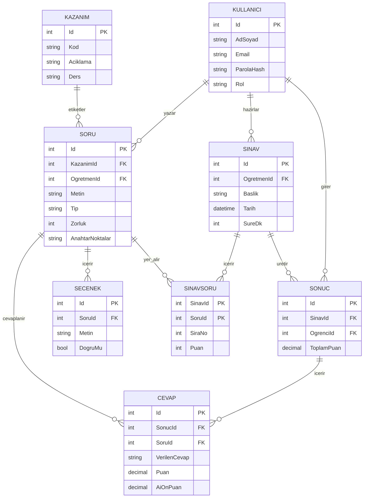

# Kazanım Bazlı Soru Bankası ve Otomatik Sınav

Öğretmenlerin kazanımlara göre etiketlenmiş sorulardan otomatik sınav oluşturmasını ve açık uçlu cevapları yapay zekâ desteğiyle ön değerlendirmesini sağlayan web uygulaması.

## Teknolojiler
- ASP.NET Core MVC (.NET 10)
- SQL Server
- Entity Framework Core

## Mimari (Katmanlı)
- **Web** → Sunum katmanı (Controller, View)
- **SoruBankasi.Business** → İş kuralları
- **SoruBankasi.Data** → Veri erişimi
- **SoruBankasi.Entities** → Varlık sınıfları

## Modüller
- Soru bankası (kazanım etiketli)
- Otomatik sınav oluşturucu
- Sınav uygulama
- Otomatik / yarı otomatik değerlendirme
- Sonuç ve kazanım analizi
- PDF dışa aktarma

## Geliştirici
Beyza Genç – Bingöl Üniversitesi, Bilgisayar Programcılığı

## Veri Modeli (ER Diyagramı)

